  

  

---

### About

Shopify developer based in Denmark.
I build and maintain Shopify stores for brands and retailers: custom themes, store architecture,
integrations and the performance work that keeps it all fast.

### What I work on

### Stack

  

### Activity

<picture>
  <source media="(prefers-color-scheme: dark)" srcset="https://raw.githubusercontent.com/TimmJensen/TimmJensen/output/github-snake-dark.svg" />
  <source media="(prefers-color-scheme: light)" srcset="https://raw.githubusercontent.com/TimmJensen/TimmJensen/output/github-snake.svg" />
  
</picture>

### Get in touch

Want to talk Shopify? Connect on [LinkedIn](https://www.linkedin.com/in/timm-m-jensen/).

